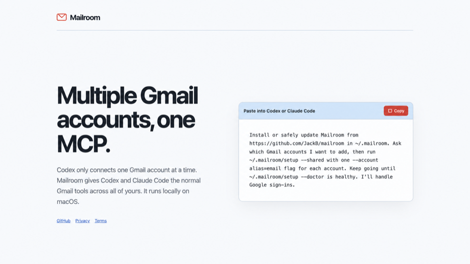

# Mailroom

I use a few Gmail accounts, and Codex only lets me connect one. So I made this.

Mailroom lets Codex, Claude Code, and Cursor use all of them. It can search, read, draft, send, forward, label, archive, and Trash mail. Everything runs locally on macOS, and tokens stay in Keychain.



You'll need macOS, Node 22+, and Codex, Claude Code, or Cursor.

**Paste this into Codex, Claude Code, or Cursor:**

```text
Install or safely update Mailroom from https://github.com/JacbK/mailroom in ~/.mailroom. Ask which Gmail accounts I want to add, then run ~/.mailroom/setup --personal with one --account alias=email flag for each account. If Mailroom opens the personal Google app guide, walk me through it and keep watching for the downloaded OAuth JSON. I'll handle Google sign-ins and clicks that need me. Keep going until ~/.mailroom/setup --doctor is healthy.
```

When setup finishes, start a new task.

Mailroom uses a personal Google app you control. The setup guide gets you through Google's screens, finds the downloaded Desktop OAuth file, moves it into Keychain, and deletes the download.

Already downloaded the file?

```sh
git clone https://github.com/JacbK/mailroom.git ~/.mailroom
~/.mailroom/setup --self-host ~/Downloads/google-oauth.json
```

[Personal Google app setup](docs/self-hosting.md)

## Use it

Say which inbox you mean. If you don't, Mailroom searches all of them:

```text
Search all my inboxes for the latest flight receipt.
Draft a reply from work to the latest message from {whoever}.
Archive these newsletters from personal.
```

IDs always stay tied to the right account. Mailroom won't send, forward, label, archive, or Trash anything unless you ask.

## If setup gets stuck

```sh
~/.mailroom/setup --doctor
~/.mailroom/setup --reauth
~/.mailroom/setup --account another=you@example.com
```

Sharing diagnostics in a bug report? Use `~/.mailroom/mailroom doctor --redact`.

If Google setup gets stuck, use the [personal app guide](docs/self-hosting.md). Done with Mailroom? Run `~/.mailroom/setup --uninstall`.

## Project

- [Security model](docs/security.md) and [private vulnerability reporting](SECURITY.md)
- [Why personal Google OAuth](docs/oauth-options.md)
- [Privacy policy](https://mailroom.jacobkieser.me/privacy.html)
- [Architecture](docs/architecture.md)
- [Contributing](CONTRIBUTING.md)
- [MIT License](LICENSE)
